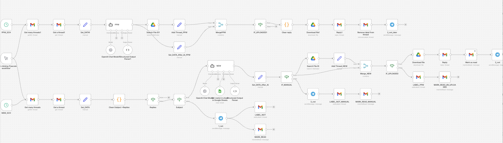
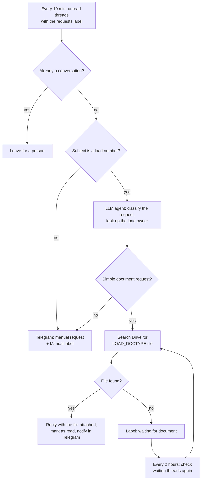

# Document request mail handler (n8n + LLM)

An n8n workflow that answers emailed requests for shipment documents at a freight brokerage: rate confirmations, carrier confirmations, BOLs.

It has been running in production for over a year.

| | |
|---|---|
| Requests handled | 10–15 a day |
| Answered with no person involved | about two thirds |
| Model cost | about $20 for the whole year |
| Stack | self-hosted n8n, OpenAI API (gpt-4.1-mini), Gmail, Google Drive, Google Sheets, Telegram |

## The problem

Customers and carriers email the brokerage all day asking for a copy of a document for a load. Each request means the same manual steps: read the email, work out which load and which document, find the file, reply with the attachment. If the document has not been uploaded yet, someone has to remember to come back to it.

## What the workflow does

1. **Cheap checks first.** Code nodes drop threads that already have replies and check that the subject looks like a load number. The model is only called for emails that pass.
2. **Classification with a fixed schema.** The agent returns the document type (RC, CC or BOL), the load number, the load owner (looked up in a Google Sheet), a short summary and a `manual_review` flag. A structured output parser enforces the schema, so later nodes never parse free text.
3. **A person for anything unclear.** Pricing questions, disputes, mixed requests and unclear subjects go to Telegram with the summary and the owner's name. The workflow replies on its own only to plain "please send me document X" emails.
4. **A waiting queue.** If the file is not on Drive yet, the thread gets a label and a second schedule rechecks it every two hours. When the file appears, the reply goes out and the label is removed.

## Why it is built this way

- The model decides what the email asks for. It never decides what to send: the file is found by its name on Drive, `<load number>_<RC|CC|BOL>`.
- "When in doubt, set manual_review = true" is written into the prompt. A wrong automatic reply to a customer costs more than a manual one.
- The prompt lists polite phrases ("do you happen to have...", "please advise") as plain document requests, so courtesy alone does not send an email to manual review.

## Known limits

- The agent reads the Gmail snippet, not the full body. Long emails with the request at the bottom can be misread.
- A Drive search by name can return more than one file. The workflow removes duplicates by file name and subject but does not pick the newest version.
- There is no error workflow yet: a failed node is only visible in the n8n execution log.

## Setup

1. Import `workflow.json` into n8n.
2. Create credentials for Gmail, Google Drive, Google Sheets, Telegram and OpenAI and select them in the nodes.
3. Replace the placeholders:
   - `YOUR_GOOGLE_SHEET_ID`: a sheet named `owners` with columns `LOAD#` and owner.
   - `YOUR_TELEGRAM_CHAT_ID`: the chat that receives notifications.
   - `LABEL_ID_DOCUMENT_REQUESTS`, `LABEL_ID_WAITING_FOR_DOCUMENT`, `LABEL_ID_MANUAL`: Gmail label IDs.
4. Name files on Drive as `<load number>_<RC|CC|BOL>`.
5. Activate the workflow.

All company data, IDs and credentials have been removed from this copy.
